# Helping Nitin Save for His Scooter

[](https://github.com/OWNER/nitin-savings-analysis/actions/workflows/ci.yml)


An expense-analytics project: where does a Rs 15,000 monthly salary go, and what can be cut so that Nitin can finally afford a scooter?

The project analyses one month of purchases (June) and six months of expenses (January to June), finds the biggest and most avoidable spending, and recommends a savings plan. It ships as a **formula-driven Excel workbook**, a **Python pipeline**, **charts**, and a **12-slide presentation**.

> **Result in one line:** capping Entertainment and Shopping and halving eating out and snacks would save about **Rs 19,140 over six months**, lifting Nitin's average monthly saving from **Rs 935 to Rs 4,125**.

---

## The problem

Nitin is a graphic designer earning **Rs 15,000 a month**. He wants to buy a scooter for his daily commute but has not been able to save for the last couple of months. His friend Ayush advised him to find where most of the money goes and cut that expense.

**Questions answered**

| Part | Question |
| --- | --- |
| 1 (June) | Which category has the highest expense? |
| 1 | What is the total spent on Entertainment and Shopping? |
| 1 | How many times did he order food online, and how much was spent? |
| 1 | How many times did he watch a movie? |
| 1 | Which less essential category can he remove? |
| 2 (6 months) | What is the month-wise trend, and in which month did he spend the most? |
| 2 | Which categories are highest and lowest? |
| 2 | Which two categories are highest in each month? |
| 2 | Which months have the highest spend on movies and dining out? |
| 2 | What is essential, what is not, and how can he save more? |

## Key findings

| | Result |
| --- | --- |
| June spend | Rs 13,560 of Rs 15,000, so only **Rs 1,440 saved** |
| Highest category (June) | **Grocery**, Rs 4,690 (34.6%); Shopping is second at Rs 3,500 |
| Entertainment + Shopping (June) | Rs 4,500 |
| Online food orders (June) | 4 times, Rs 600 |
| Movies (June) | 4 times, Rs 1,000 |
| Category to remove first | **Shopping** (Rs 3,500) |
| Highest-spend month | **February**, Rs 15,620 (includes a Rs 7,500 trip) |
| Highest / lowest category (6 months) | Grocery Rs 30,990 / Doctor and Medicine Rs 4,000 |
| Top category per month | Grocery in 5 of 6 months (February: Entertainment) |
| Movies peak / dining out peak | June / January (Rs 1,000 each) |
| Essential vs less essential | Rs 51,030 (60.5%) vs Rs 25,640 (30.4%); Miscellaneous Rs 7,720 (9.1%) |
| Average saving per month | **Rs 935 today**, and Rs 620 short in February |

### June

<p align="center">
  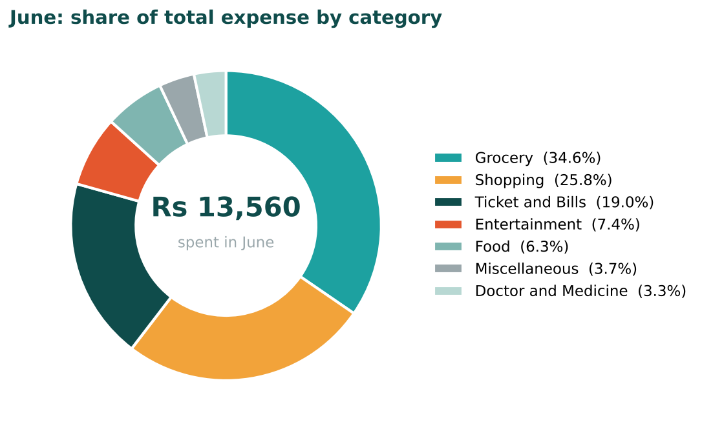
  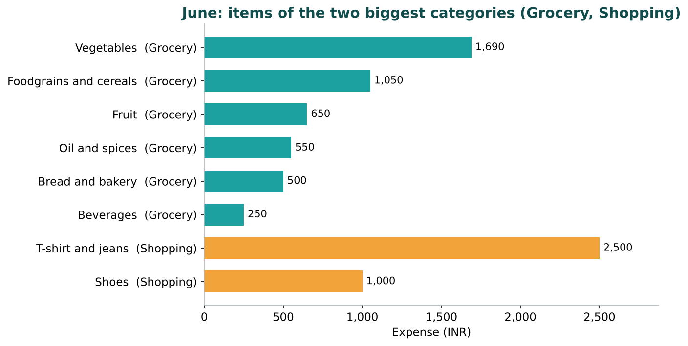
</p>
<p align="center">
  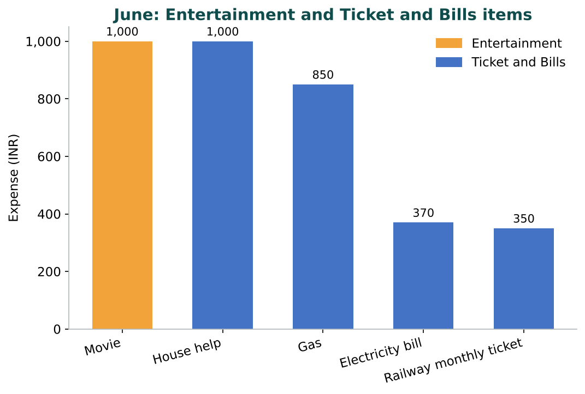
</p>

### Six months

<p align="center">
  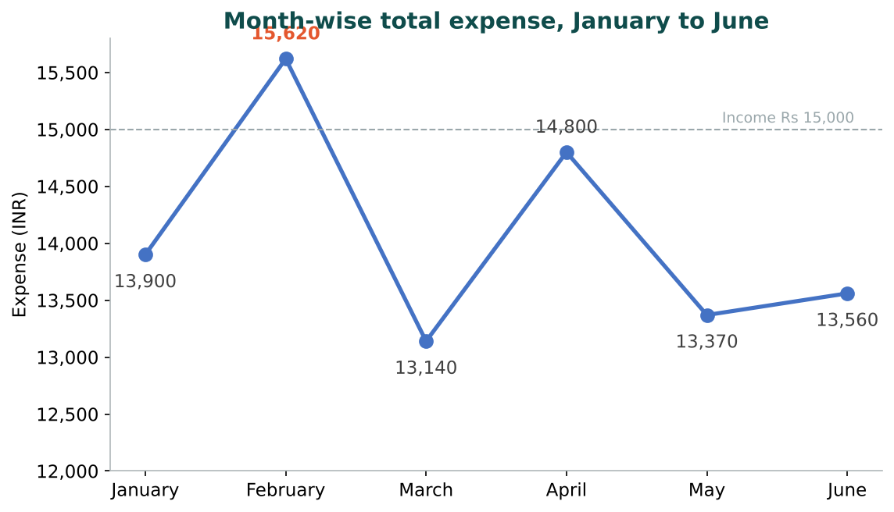
  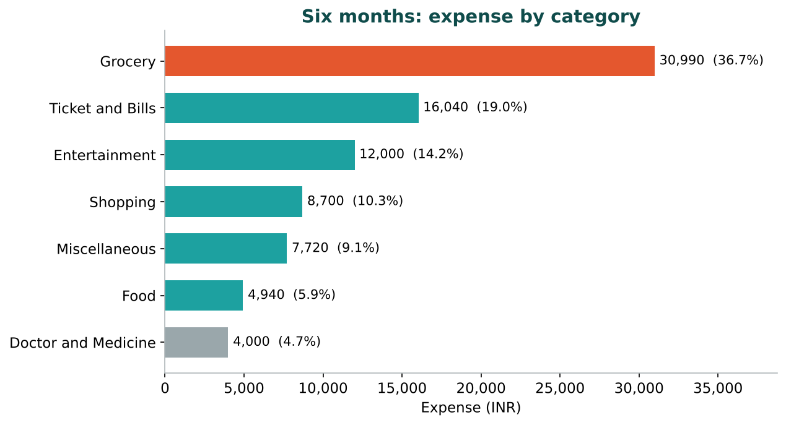
</p>
<p align="center">
  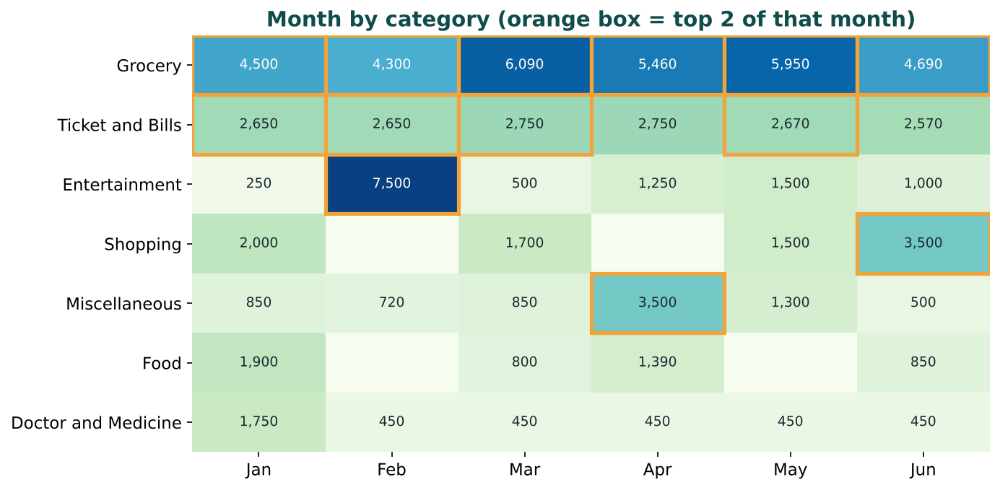
  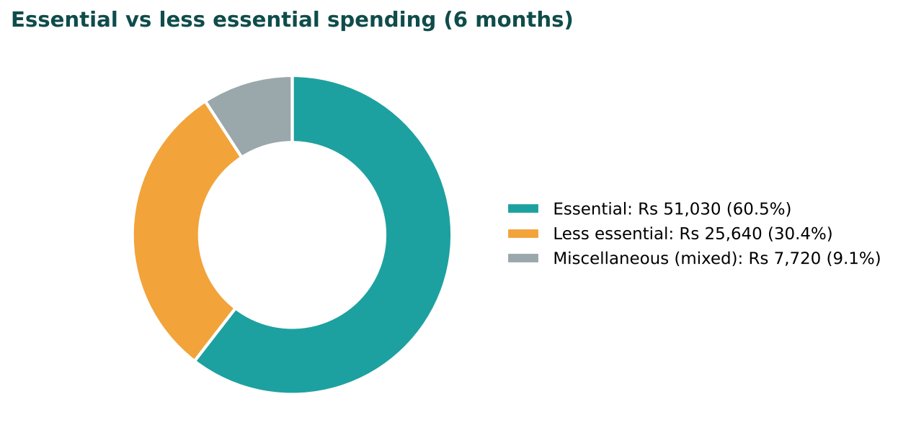
</p>

## Recommendations

Caps apply month by month, so a month already under the cap saves nothing.

| Where to cut | What to do | Reason | Saving (6 months) |
| --- | --- | --- | --- |
| Entertainment | Cap at Rs 500 a month; plan trips from a separate fund | Rs 9,500 of the Rs 12,000 came from one trip and two outings | **Rs 9,250** |
| Shopping | Cap at Rs 1,000 a month | Clothes and shoes; nothing was bought in February or April, so it can be skipped | **Rs 4,700** |
| Food | Halve dining out, online orders and chips | Eating out while groceries were already bought | **Rs 2,470** |
| Snacks (inside Grocery) | Halve packaged snacks | Rs 5,440 in six months, more than the whole Food category | **Rs 2,720** |
| **Total** | | About Rs 3,190 more saved per month | **Rs 19,140** |

<p align="center">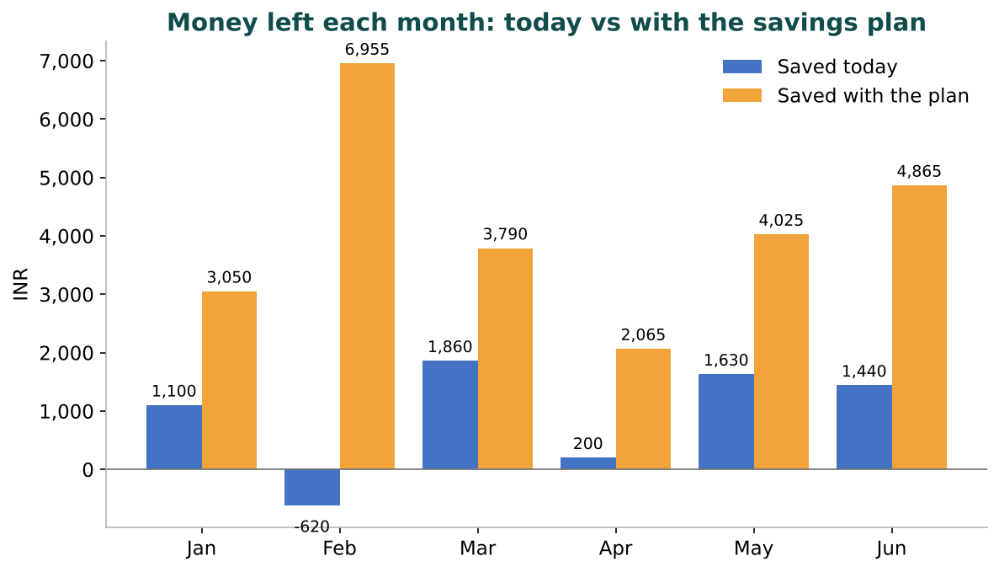</p>

Essentials (Grocery staples, bills, his mother's medicine) are left untouched.

## Repository structure

```
nitin-savings-analysis/
├── main.py                       # run everything
├── data/raw/                     # the two source Excel files
│   ├── part1_june_expenses.xlsx
│   └── part2_six_month_expenses.xlsx
├── src/
│   ├── config.py                 # income, groups and savings-plan assumptions
│   ├── data.py                   # load and clean the data
│   ├── analysis.py               # all pivot-table logic in pandas
│   ├── charts.py                 # matplotlib charts
│   └── workbook.py               # builds the Excel workbook with live formulas
├── tests/test_analysis.py        # checks every number quoted above
├── outputs/
│   ├── Nitin_Expense_Analysis.xlsx
│   ├── charts/*.png
│   └── tables/*.csv
├── presentation/Nitin_Savings_Presentation.pptx
├── docs/presentation_script.md   # slide-by-slide speaking script
└── .github/workflows/ci.yml      # runs the tests on every push
```

## Getting started

```bash
git clone https://github.com/OWNER/nitin-savings-analysis.git
cd nitin-savings-analysis
python -m venv .venv && source .venv/bin/activate   # Windows: .venv\Scripts\activate
pip install -r requirements.txt

python main.py      # regenerates tables, charts and the Excel workbook
pytest -q           # verifies the numbers
```

To try a different plan, edit the assumptions in `src/config.py` (or the yellow cells on the workbook's `Inputs` sheet) and run again.

## The Excel workbook

`outputs/Nitin_Expense_Analysis.xlsx` is the "done in Excel" version of the project. Every summary table uses `SUMIFS` / `COUNTIFS` on the raw-data sheets, so changing a purchase or an assumption updates every table, chart and highlight.

| Sheet | Contents |
| --- | --- |
| `Summary` | Key numbers and links to every sheet |
| `Inputs` | Income, caps, cut percentages and the category groups (editable) |
| `June_Data`, `SixMonth_Data` | Raw data |
| `June_Category` | Spend by category, % of total, pie chart |
| `June_Items` | Items, times spent, amount; filter for Grocery and Shopping; data bars; Entertainment and Bills chart |
| `June_Findings` | Answers to the five Part 1 questions |
| `Monthly_Trend` | Month-wise totals, highest month highlighted, line chart |
| `Category_Totals` | Category-wise expense with data bars; green = highest, red = lowest |
| `Month_x_Category` | Month by category matrix with the top two of each month highlighted |
| `Items_EFS` | Entertainment, Food and Shopping items by month with peak month |
| `Essential_Split` | Essential vs less essential with a pie chart |
| `Savings_Plan` | Month-by-month savings plan, recommendations and impact chart |

The tables are pivot-style summaries built with formulas rather than Excel PivotTable objects. To make native PivotTables from the same data, select the data sheet and choose **Insert > PivotTable**, then drag *Category* to Rows and *Expense (INR)* to Values (use *Month* or *Item* as Rows or Columns for the other views).

## Method and assumptions

- **Data cleaning:** item names are normalised (for example `Online Food Order` and `Online food order` are the same item) and three spellings are fixed (`Tshirt and jeans`, `North Bengal trip`, `Brother's tuition fee`).
- **June data matches Part 2:** the June rows of the six-month file total Rs 13,560, the same as the daily June file (checked by a test).
- **Income** is taken as Rs 15,000 in every month; the data does not state it.
- **Essential vs less essential** is a judgement call: Grocery, Ticket and Bills and Doctor and Medicine are essential; Entertainment, Shopping and Food are less essential; Miscellaneous (gifts, tuition, auto fare) is left alone. "Snacks" sit inside Grocery in the data but are treated as not essential in the plan.
- **Savings caps** (Rs 500 entertainment, Rs 1,000 shopping, halve food and snacks) are suggestions. They are inputs, not facts.
- The scooter's price is not given, so the project does not estimate how long it will take to afford it.

## Presentation

`presentation/Nitin_Savings_Presentation.pptx` is a 12-slide deck with speaker notes. The slide-by-slide script is in [`docs/presentation_script.md`](docs/presentation_script.md).

<p align="center">
  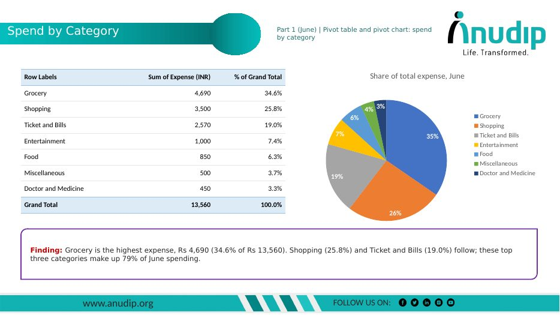
  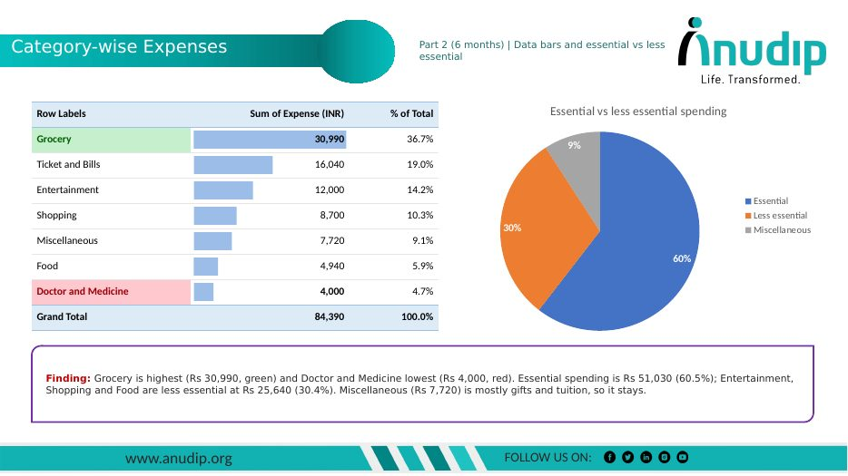
</p>
<p align="center">
  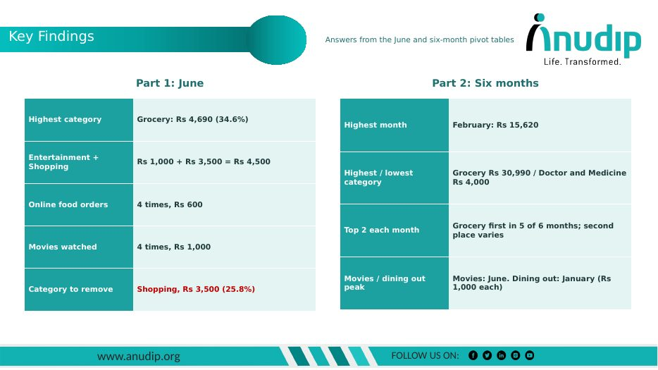
  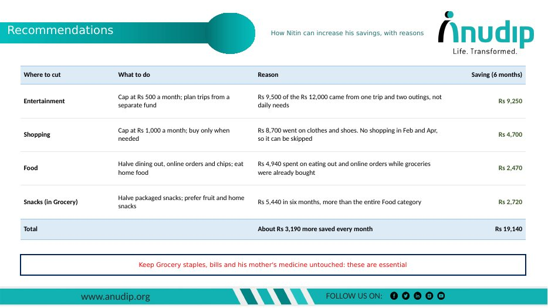
</p>

## Author

**Sana Afrin**

Released under the [MIT License](LICENSE).
