# Presentation script

Speaking notes for the 12-slide deck in [`presentation/`](../presentation/Nitin_Savings_Presentation.pptx). The same text is stored in the deck's speaker notes (open Presenter View).

## Slide 1: Title

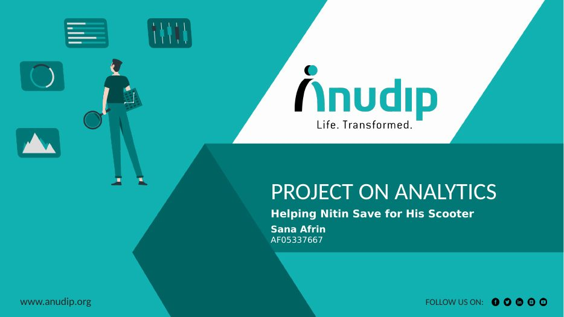

Good morning. I am Sana Afrin. My project is on analytics: helping Nitin save for his scooter. I used Excel pivot tables and charts on his expense data, first for June and then for the last six months.

## Slide 2: Problem statement

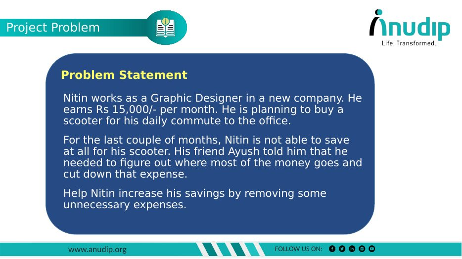

Nitin is a graphic designer earning Rs 15,000 a month. He wants a scooter for his daily commute, but for the last couple of months he has not been able to save at all. His friend Ayush advised him to find where his money goes and cut that expense. My job is to find those expenses and recommend what to remove.

## Slide 3: Spend by Category (June)

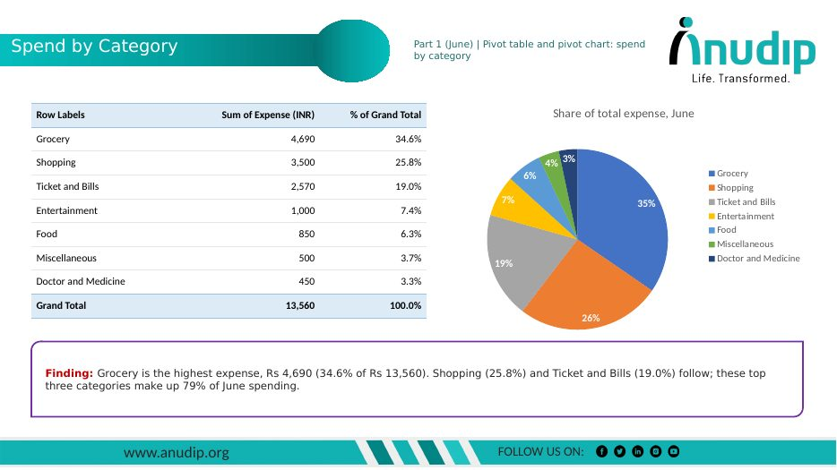

First, June. Nitin spent Rs 13,560 in total. Grocery is the largest at Rs 4,690, which is 34.6 percent. Shopping is second at Rs 3,500 and Ticket and Bills is third at Rs 2,570. These three make up about 79 percent of his June spending. The pie chart shows the same shares.

## Slide 4: Items and Frequency (June)

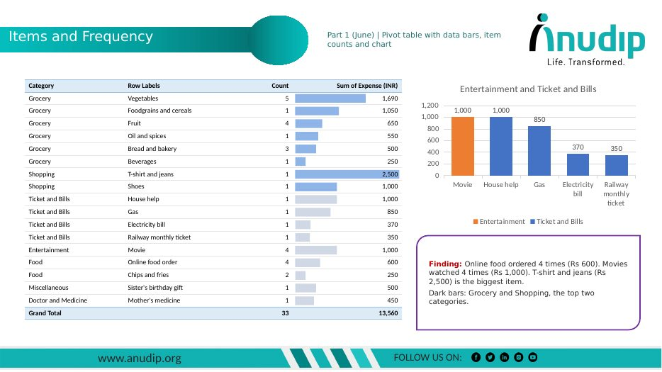

This pivot shows every item with how many times he spent and the amount, with data bars. The dark bars are Grocery and Shopping, the top two categories. The biggest single item is T-shirt and jeans at Rs 2,500. He ordered food online 4 times for Rs 600 and watched 4 movies for Rs 1,000. The chart on the right shows Entertainment is only movies, while house help and gas lead the bills.

## Slide 5: Monthly Trend (six months)

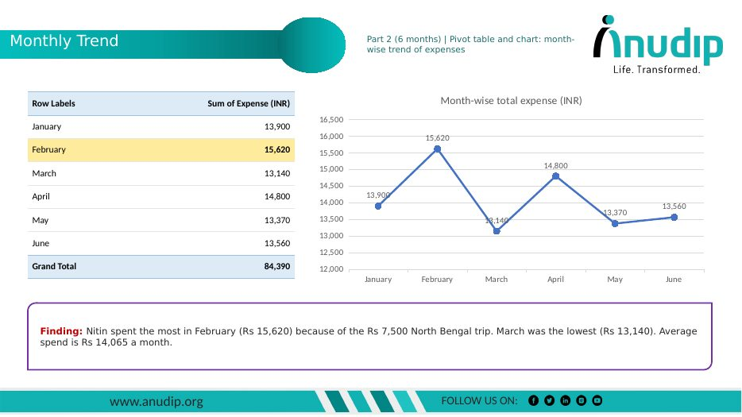

Now the last six months. February is the highest at Rs 15,620, mainly because of the Rs 7,500 North Bengal trip. March is the lowest at Rs 13,140. His average spending is about Rs 14,065 a month, which leaves very little out of Rs 15,000.

## Slide 6: Category-wise Expenses

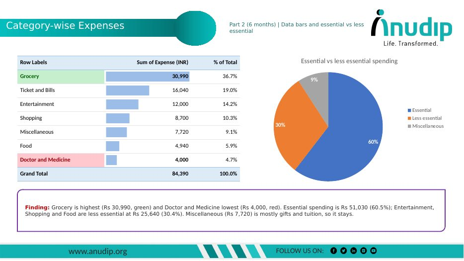

Over six months Grocery is the highest category at Rs 30,990, shown in green. Doctor and Medicine is the lowest at Rs 4,000, shown in red. On the right I split spending into essential and less essential. Essential is Grocery, bills and his mother's medicine: Rs 51,030, about 60 percent. Entertainment, Shopping and Food are less essential: Rs 25,640, about 30 percent. Miscellaneous is mostly gifts and tuition, so I leave it.

## Slide 7: Monthly Category Analysis

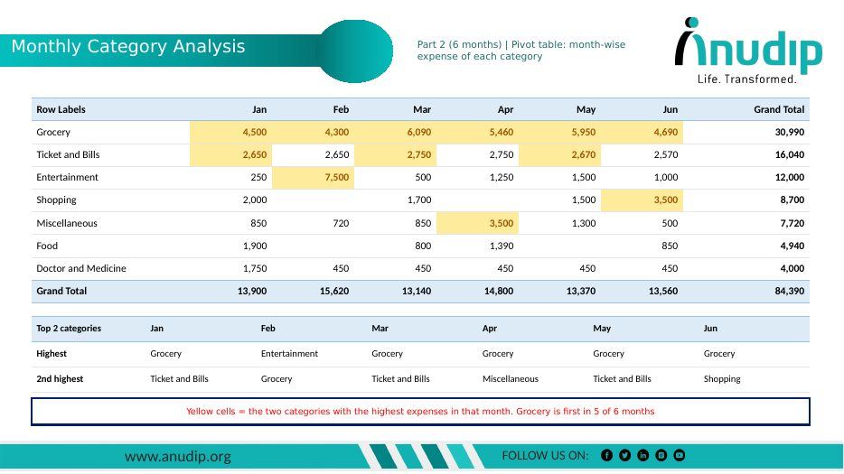

This pivot shows each category month by month. The yellow cells mark the top two categories in each month. Grocery is first in five of the six months. In February Entertainment was first because of the trip. The second place changes between Ticket and Bills, Miscellaneous in April and Shopping in June.

## Slide 8: Discretionary Items

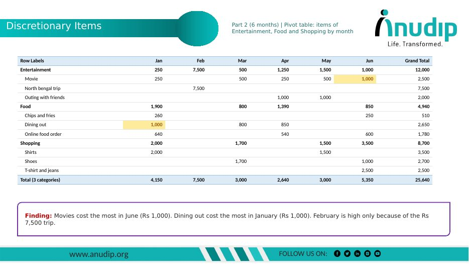

Here I look at Entertainment, Food and Shopping item by item. Movies cost the most in June, Rs 1,000. Dining out cost the most in January, Rs 1,000. February is high only because of the Rs 7,500 trip. These are the items that go up and down by choice.

## Slide 9: Key Findings

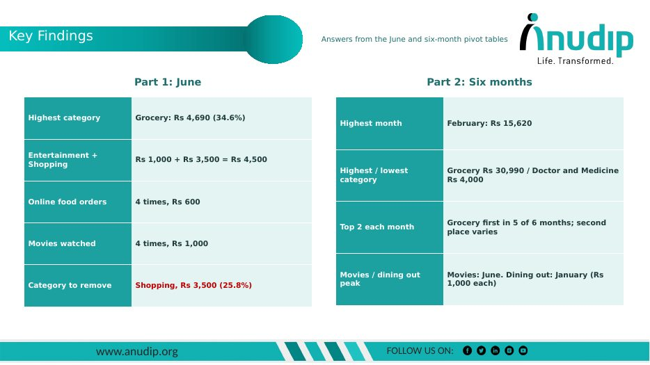

These are the key answers. In June: the highest category is Grocery, Entertainment plus Shopping is Rs 4,500, online food was ordered 4 times for Rs 600, movies 4 times for Rs 1,000, and the category to remove is Shopping at Rs 3,500. Over six months: the highest month is February, Grocery is the top category and is first in five months, and movies peaked in June while dining out peaked in January.

## Slide 10: Recommendations

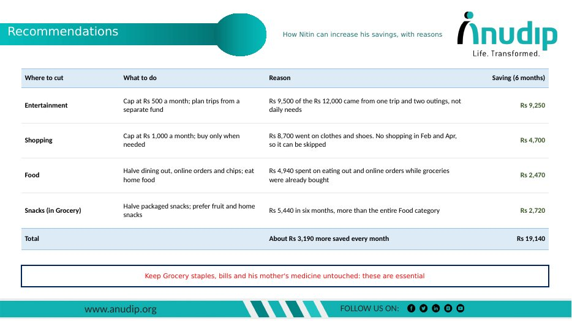

My recommendations, with reasons. One: cap Entertainment at Rs 500 a month, because Rs 9,500 of the Rs 12,000 came from one trip and two outings. This saves Rs 9,250. Two: cap Shopping at Rs 1,000 a month; he spent nothing in February and April, so it is skippable. This saves Rs 4,700. Three: halve dining out, online orders and chips, saving Rs 2,470. Four: halve packaged snacks, saving Rs 2,720. In total about Rs 19,140 over six months, roughly Rs 3,190 a month. Essentials stay untouched.

## Slide 11: Impact on Savings

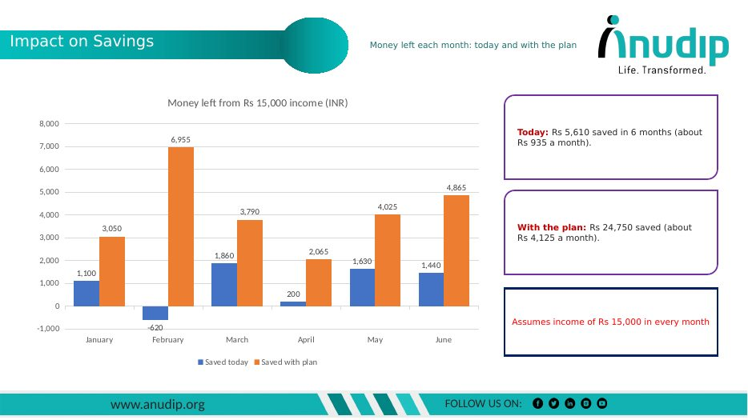

This chart compares money left each month today with the plan. Today he saves Rs 5,610 in six months, about Rs 935 a month, and February is negative. With the plan he would save about Rs 24,750, around Rs 4,125 a month. I assumed his income stays Rs 15,000 every month.

## Slide 12: Thank You and Conclusion

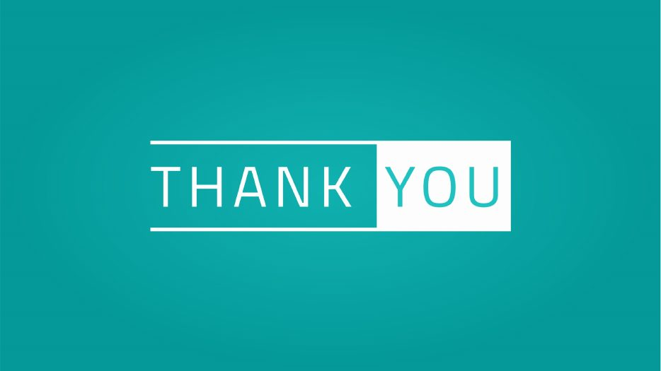

In conclusion, Nitin's money mostly goes on groceries and fixed bills, which he needs. The savings are in entertainment, shopping, eating out and snacks. With these limits he can save over four times more each month and reach his scooter sooner. Thank you. I am happy to take questions.

## Likely questions

- **Why Rs 500 and Rs 1,000?** They are suggested caps, not fixed rules. Change them on the `Inputs` sheet of the workbook (or in `src/config.py`) and every figure updates.
- **How was the analysis done?** Pivot-style tables with data bars, filters and highlighting in Excel; the same logic is reproduced in pandas and checked by tests.
- **Why is Miscellaneous kept?** It holds gifts and his brother's tuition fee, which are mostly needed.
- **Why is February so high?** A single Rs 7,500 North Bengal trip.
